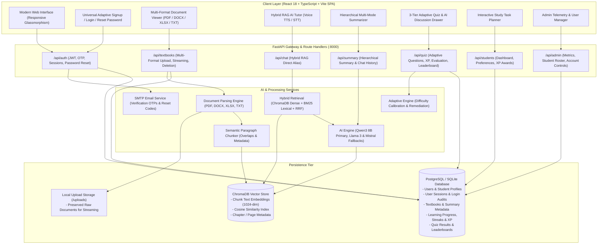

# AARVA – AI-Based Adaptive Learning & Document Intelligence System

[](https://fastapi.tiangolo.com)
[](https://react.dev)
[](https://www.trychroma.com)
[](https://ollama.com)
[](https://www.postgresql.org)

**AARVA** is an adaptive, AI-driven learning and document intelligence platform designed for learners of all backgrounds — school students, college undergraduates, working professionals, and lifelong learners. It transforms static textbooks, lecture notes, syllabus decks, and enterprise documents into dynamic, personalized learning experiences with real-time AI tutoring, multi-format document visualization, interactive study planning, and gamified mastery challenges.

---

## 🌟 Key Features

### 1. Universal Multi-Step Adaptive Sign-Up & Authentication
- **4 Dynamic Learner Personas**: School Student, College Student, Working Professional, Independent Learner — each with tailored fields (grades, boards, degrees, semesters, or industry roles).
- **Animated 4-Step Stepper**: Basic Info → Learner Profile → Interests & Goals → Learning Preferences.
- **OTP Verification & Password Recovery**: Automated 4-digit email verification and self-service password reset powered by SMTP.
- **Multilingual Support**: Real-time localization in 6 languages (English, Hindi, Tamil, Telugu, Spanish, French).
- **Voice Assistance**: Full speech synthesis (Text-to-Speech) and microphone speech recognition (Speech-to-Text) powered by the Web Speech API.
- **Adaptive Dark / Light Theme**: High-contrast, accessibility-compliant glassmorphism design with seamless theme persistence.

### 2. Multi-Format Document Ingestion & Dual-View Workspace
- **Multi-Format Ingestion**: Upload and index **PDFs, Word documents (`.docx`), Excel spreadsheets (`.xlsx`), and plain text (`.txt`)** up to 50 MB.
- **Dual-Pane Interactive Study Environment**:
  - **Left Pane (Document & RAG Tutor)**: Switch seamlessly between the native Document Viewer (PDF viewer, spreadsheet grid, document text) and the AI Tutor Chat.
  - **Right Pane (Textbook Summarizer)**: Explore 5 focused study modes:
    1. *Complete Book / Document Overview*
    2. *Chapter-wise & Section Breakdown*
    3. *Core Concepts & Theoretical Frameworks*
    4. *Glossary & Technical Definitions*
    5. *Important Notes & Examination Takeaways*
- **Export & Study Aids**: One-click Markdown copy and formatted print view for offline study.

### 3. Hybrid RAG (Dense + BM25) AI Tutor
- **Reciprocal Rank Fusion (RRF)**: Combines dense vector embeddings (ChromaDB) with lexical keyword matching (BM25) for high-accuracy textbook retrieval.
- **Grounded Citations**: The AI tutor provides exact chapter and page citations for every factual explanation, eliminating hallucinations.
- **Conversational Memory & Follow-ups**: Contextual session history with automated follow-up suggestions and spoken audio readouts.

### 4. 3-Tier Adaptive Concept Challenge & AI Remediation
- **Tiered Difficulty Engine**: Dynamic practice quizzes divided into **Basic (Foundations)**, **Medium (Application)**, and **Advanced (Analysis)** levels.
- **Wrong-Answer AI Discussion Drawer**: In-depth pedagogical explanations for missed questions, enabling students to "Discuss with AI Tutor" directly from the score report.
- **Retest Mode**: Retest incorrect questions or regenerate randomized question sets calibrated to the learner's knowledge gaps.
- **Gamified Rewards & Analytics**: Real-time XP awarding, level titles (*Architecture Scholar*, *Master of Networks*), daily streak tracking (🔥), and top-tier leaderboards.

### 5. Interactive Study Task Planner
- **Interactive Task Dashboard**: Add personalized study tasks (`+ Add task`) with custom duration presets (15 min, 30 min, 45 min, 60 min).
- **Interactive Checkbox Completion**: Strikethrough completed tasks and track ongoing daily goals.
- **Per-User Isolation**: Tasks, uploaded textbooks, quiz history, and learning progress are strictly isolated per `user_id`. New student accounts start with a clean workspace.

### 6. Admin Portal ("AARVA User Management")
- **Platform Telemetry**: Real-time metrics tracking Total Students, Active Device Sessions, Indexed Documents, and Average Quiz Performance.
- **Student Roster & Filters**: Search by name or email and filter across the 4 learner personas.
- **Deep Account Inspection**: Inspect complete profile metadata, uploaded books, login activity audit trails, and device fingerprints.
- **Account Status Management**: One-click student account suspension and reactivation.

---

## 🏗️ System Architecture



---

## 🛠️ Tech Stack

| Layer | Technology | Purpose |
|---|---|---|
| **Frontend Framework** | **React 18** + **TypeScript** | Responsive, high-performance Single Page Application (SPA) |
| **Build Tool & Bundler** | **Vite** | Lightning-fast HMR and optimized production asset bundling |
| **Styling & Design** | **Vanilla CSS & CSS Modules** + **Lucide Icons** | Bespoke glassmorphism design, adaptive themes, accessible layouts |
| **Audio & Speech** | **Web Speech API** (TTS & STT) | Voice tutor reading and hands-free microphone queries |
| **Backend Framework** | **FastAPI** (Python 3.10+) | High-throughput asynchronous REST API with auto OpenAPI/Swagger docs |
| **Database & ORM** | **PostgreSQL** / **SQLite** + **SQLAlchemy** | Multi-table relational store with cascading deletes and session tracking |
| **Vector Database** | **ChromaDB** | Semantic embedding storage, cosine distance search, and metadata filtering |
| **Document Parsing** | **pypdf**, **python-docx**, **openpyxl** | Ingestion of PDFs, Word documents, Excel spreadsheets, and raw text |
| **Retrieval Engine** | **Hybrid RRF (Dense + BM25)** | Reciprocal Rank Fusion combining Chroma embeddings with lexical BM25 matching |
| **AI Inference** | **Qwen (qwen3:8b / qwen2.5)** *(Primary)*, with **Llama 3** & **Mistral** fallbacks | Multi-tier summarization, concept maps, adaptive quiz generation, and grounded RAG tutor chat |
| **Security & Auth** | **JWT (HS256)** + **Bcrypt** + **SMTP** | Token-based auth with session tracking (`UserSession`), OTP emails, password resets |

---

## 📁 Repository Structure

```
d:\Aarva\
├── frontend/                     # React 18 / TypeScript / Vite Application
│   ├── public/                   # Static assets (transparent PNG icons & logos)
│   ├── src/
│   │   ├── components/
│   │   │   ├── AarvaLogo.tsx     # Custom AARVA brand logo component
│   │   │   ├── Navbar.tsx        # Topbar with Voice, Lang, Theme, Demo switcher
│   │   │   ├── BottomNav.tsx     # Mobile-friendly navigation bar
│   │   │   ├── UniversalSignup.tsx # 4-step dynamic adaptive registration stepper
│   │   │   ├── StudentPortal.tsx # Dual-view learning space coordinator
│   │   │   ├── SummarizerView.tsx# 5-tier document summarizer & print/export
│   │   │   ├── AIChat.tsx        # Hybrid RAG tutor chat with voice TTS/STT
│   │   │   ├── QuizModule.tsx    # 3-tier adaptive quiz with AI discussion drawer
│   │   │   ├── ProgressView.tsx  # Concept mastery meters & streak analytics
│   │   │   └── AdminPortal.tsx   # Admin telemetry, student roster, session logs
│   │   ├── context/
│   │   │   ├── AuthContext.tsx   # Auth state, user profile, demo switcher
│   │   │   └── ThemeContext.tsx  # Theme, localization dictionary, speech engine
│   │   └── services/api.ts       # Typed Axios client for FastAPI endpoints
│   ├── package.json              # Frontend dependencies and build scripts
│   └── vite.config.ts            # Vite bundler configuration
├── backend/                      # FastAPI Python Application
│   ├── app.py                    # Main ASGI app, CORS middleware, startup seeder
│   ├── config.py                 # Central settings & typed .env configuration
│   ├── models/models.py          # SQLAlchemy ORM models (users, sessions, quizzes)
│   ├── database/
│   │   ├── postgres.py           # Database engine & demo seed data
│   │   └── chroma.py             # ChromaDB vector collection & RAG retrieval
│   ├── routes/
│   │   ├── auth.py               # Signup, login, OTP, reset-password, sessions
│   │   ├── admin.py              # System metrics, student roster, status toggle
│   │   ├── students.py           # Dashboard stats, study tasks, XP awards
│   │   ├── textbooks.py          # File upload (PDF/DOCX/XLSX), serving, deletion
│   │   ├── summary.py            # Hierarchical summaries, chat history, RAG query
│   │   └── quiz.py               # 3-tier adaptive quizzes, answer grading, leaderboard
│   ├── services/
│   │   ├── llama_service.py      # Qwen/Llama/Mistral inference & RAG chat
│   │   ├── email_service.py      # SMTP OTP & password reset email dispatcher
│   │   └── adaptive_service.py   # Adaptive difficulty calibration logic
│   └── requirements.txt          # Python dependencies
└── docs/                         # Detailed system documentation
    ├── ARCHITECTURE.md           # Architecture, flowcharts & sequence diagrams
    ├── DB_SCHEMA.md              # Database schema & entity-relationship diagrams
    └── API_OVERVIEW.md           # Complete REST API endpoint reference
```

---

## ⚙️ Setup & Configuration

### 1. Prerequisites
- **Node.js** (v18 or higher) and `npm`
- **Python** (v3.10 or higher)
- **Ollama** (optional for local LLM inference, e.g. `ollama run qwen3:8b` or `ollama run llama3`)

### 2. Backend Setup
```bash
cd backend

# Create and activate virtual environment
python -m venv venv
# Windows:
venv\Scripts\activate
# Linux/macOS:
# source venv/bin/activate

# Install dependencies
pip install -r requirements.txt
```

#### Backend Environment Configuration (`backend/.env`)
Create a `.env` file in `backend/` with the following parameters:
```ini
# Application
APP_NAME="AARVA AI Document & Learning System"
APP_ENV=development
APP_PORT=8000
DEBUG=true

# Database (PostgreSQL or local SQLite fallback)
DATABASE_URL=sqlite:///./aarva.db

# Authentication
JWT_SECRET=your-secure-jwt-secret-key-here
JWT_ALGORITHM=HS256
JWT_ACCESS_TOKEN_EXPIRE_MINUTES=10080

# Document Ingestion
UPLOAD_DIR=./uploads
MAX_UPLOAD_SIZE_MB=50
ALLOWED_FILE_TYPES=pdf,docx,xlsx,txt

# Vector Store (ChromaDB)
CHROMA_PERSIST_DIR=./chroma_db
CHROMA_COLLECTION_NAME=aarva_knowledge_base
CHROMA_DISTANCE_FUNCTION=cosine

# LLM & Embedding Settings (Ollama / Local or Remote)
OLLAMA_BASE_URL=http://localhost:11434
EMBEDDING_PROVIDER=ollama
EMBEDDING_MODEL=bge-large:latest
EMBEDDING_DIMENSION=1024
LLM_PROVIDER=ollama
LLM_MODEL=qwen3:8b
LLM_TEMPERATURE=0.3

# Hybrid Retrieval Settings
RETRIEVAL_METHOD=hybrid
RRF_K=60
RRF_DENSE_WEIGHT=0.65
RRF_SPARSE_WEIGHT=0.35
RETRIEVAL_TOP_K=4

# SMTP Email Configuration (for OTP verification & password reset)
SMTP_HOST=smtp.gmail.com
SMTP_PORT=587
SMTP_USER=your-email@gmail.com
SMTP_PASSWORD=your-app-password
SMTP_FROM_NAME="Aarva Learning"
SMTP_USE_TLS=true
```

### 3. Frontend Setup
```bash
cd ../frontend
npm install
```

---

## 🚀 Running Locally

### 1. Start the FastAPI Backend Server
```bash
cd backend
python -m uvicorn app:app --port 8000 --reload
```
- **Backend API**: `http://127.0.0.1:8000`
- **Interactive Swagger Docs**: `http://127.0.0.1:8000/docs`
- **Health Check**: `http://127.0.0.1:8000/api/health`

### 2. Start the React Frontend Application
```bash
cd frontend
npm run dev
```
Open `http://localhost:5173` in any modern web browser.

---

## 🔑 Demo Accounts

Use these pre-seeded accounts to explore different user personas and the administrator dashboard:

| Role | Email | Password | Persona / Details |
|---|---|---|---|
| **College Student** (Default) | `student@college.edu` | `student123` | Alex Morgan (CSE 3rd Year, IIT Madras) |
| **School Student** | `priya.patel@school.edu` | `student123` | Priya Patel (Class 11 CBSE, DPS RK Puram) |
| **Working Professional** | `rohan.iyer@techcorp.com` | `student123` | Rohan Iyer (Cloud Solutions Architect) |
| **Independent Learner** | `elena.rostova@global.org` | `student123` | Elena Rostova (Data Science & AI Explorer) |
| **Platform Administrator** | `admin@aarva.edu` | `admin123` | AARVA Platform Administrator |

---

## 📚 Documentation Reference

For in-depth architectural specifications, entity-relationship diagrams, and endpoint contracts, explore the documentation in [`docs/`](file:///d:/Aarva/docs/):
- 📘 [Architecture Overview & Workflow Diagrams](file:///d:/Aarva/docs/ARCHITECTURE.md)
- 🗄️ [Database Schema & ER Diagrams](file:///d:/Aarva/docs/DB_SCHEMA.md)
- 🔌 [API Endpoints & Integration Reference](file:///d:/Aarva/docs/API_OVERVIEW.md)

---

## 🎥 Project Demo Video

- **Watch the Video Walkthrough on Google Drive**: [AARVA System Demo Video](https://drive.google.com/file/d/1ybVgyU1iQzW7RVQTdciTqkYm3qatSfJi/view?usp=sharing)


