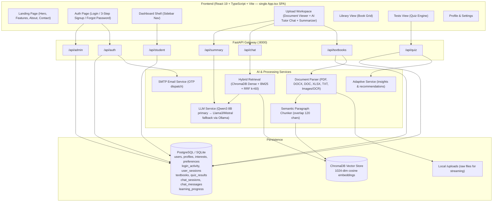

# AARVA — AI-Based Adaptive Learning & Document Intelligence System

[](https://fastapi.tiangolo.com)
[](https://react.dev)
[](https://www.trychroma.com)
[](https://ollama.com)
[](https://www.postgresql.org)

**AARVA** is an AI-driven learning and document intelligence platform that transforms uploaded textbooks, lecture notes, and documents into interactive learning experiences — with an AI tutor, multi-mode summarizer, adaptive quizzes, and a study task planner.

---

## 🌟 Key Features

### 1. Authentication & Account Management
- **Login**: Email and password login for students; JWT token issued on success and stored in `localStorage`.
- **Signup (3 steps)**: Personal info → Interests & preferences → Email OTP verification.
  - Learner types supported: `school`, `college`, `professional`, `independent`.
  - Captures: institution, department, year/semester/grade/job role, subjects, goals, and learning preferences (TTS, STT, font size, etc.).
- **Forgot Password**: Email OTP dispatch via SMTP → 4-digit code entry → new password set; auto-login on success.
- **Session Tracking**: Every login creates a `UserSession` row (JWT `jti`, IP, device, expiry). Logout revokes all active sessions for the user.

### 2. Multi-Format Document Ingestion
- **Supported formats**: PDF (`.pdf`), Word (`.docx`, `.doc`), Excel (`.xlsx`), plain text (`.txt`, `.md`, `.csv`, `.rst`), and images (`.png`, `.jpg`, `.jpeg`, `.bmp`, `.tiff`, `.webp`) via OCR (EasyOCR + pytesseract fallback).
- **Ingestion pipeline**: Parse raw file → Semantic paragraph chunking (120-char overlap) → Embed into ChromaDB → Store metadata & summary in PostgreSQL/SQLite.
- **File serving**: Raw uploaded files streamed back to the browser with the correct `Content-Type` for in-browser preview.
- **Deletion**: Removes the database record, all associated ChromaDB vector chunks, and the local file on disk.

### 3. Document Summarizer (5 Modes)
Pre-computed `summary_data` stored at upload time, or generated on-demand via LLM:
1. **Complete Overview** — high-level summary, key points, topics covered, chapters, definitions, and important notes.
2. **Chapter Breakdown** — per-chapter summary with key points and definitions.
3. **Core Concepts** — concept-focused AI generation.
4. **Page/Section** — page-level AI generation.
5. **Chat History** — stored conversation messages per textbook session (retrieved separately).

### 4. Hybrid RAG AI Tutor Chat
- **Hybrid Retrieval**: ChromaDB dense vector search (1024-dim cosine) + BM25 sparse lexical search, merged via **Reciprocal Rank Fusion (RRF)** (`k=60`, dense weight 0.65, sparse weight 0.35).
- **AI Engine**: Qwen3 8B (primary via Ollama) with automatic fallback to Llama 3, Mistral, or any available local model.
- **Multi-turn conversation**: Full conversation history passed on every request for context continuity.
- **Chat persistence**: Messages saved into `ChatSession` / `ChatMessage` rows in the database when `user_id` and `textbook_id` are provided.
- **Direct alias**: `POST /api/chat` mirrors `POST /api/summary/chat`.

### 5. Adaptive Quiz Engine
- **AI-generated questions**: Uses Hybrid RAG + LLM to generate questions directly from the uploaded document. Falls back to a curated static question bank when Ollama is unavailable.
- **Difficulty levels**: `easy`, `medium`, `hard`, or `mixed`.
- **Submission & scoring**: Correct count, percentage, XP award (50 XP base + bonus up to 30 XP for ≥ 75%), performance feedback message, and badge unlocks.
- **Badges unlocked on quiz**: `Quiz Ace` (≥ 90%), `Perfect Score` (100%), `Knowledge Seeker` (5+ quizzes completed).
- **Leaderboard**: Top 10 students by XP from `LearningProgress`; falls back to a static mock list if no data exists.

### 6. Student Dashboard
- **Overview cards**: Books uploaded count and points earned (books × 80).
- **Study Task Planner**: Add custom tasks with duration presets (15, 30, 45, 60 min). Tasks are persisted per user via `localStorage`.
- **Library view**: Grid of all uploaded books; open a book to enter the document viewer + AI tutor workspace.
- **Tests view**: Start quizzes against any uploaded book.
- **Profile view**: Displays name, email, and total book count.
- **Settings view**: Toggle learning preferences (TTS, STT, larger text, simplified explanations); saved via `PUT /api/student/preferences/{user_id}`.

### 7. Admin Portal
- **Metrics**: Total registered users and count of active sessions (login activity in the last 4 hours).
- **Student roster**: List all users, searchable by name/email and filterable by learner type.
- **Student detail view**: Full profile data and login activity log (last 10 entries).
- **Account control**: Toggle student account active/inactive status with a single click.
- **Admin access**: Admin accounts are seeded at startup; admin login is not accessible from the student portal.

---

## 🏗️ System Architecture



---

## 🛠️ Complete Tech Stack & Libraries

### 1. Frontend Technologies & Libraries (`frontend/package.json`)

| Package / Tool | Version | Category | Role in AARVA |
| :--- | :--- | :--- | :--- |
| **`react`** | `^19.0.0` | UI Library | Core reactive component tree, custom hooks, and virtual DOM management |
| **`react-dom`** | `^19.0.0` | DOM Renderer | Browser DOM rendering and root mounting engine |
| **`typescript`** | `^5.7.0` | Language | Strict static typing for all components, props, state, and API payload schemas |
| **`vite`** | `^8.0.5` | Build Tool | Lightning-fast development server with Native ESM and Hot Module Replacement (HMR) |
| **`@vitejs/plugin-react`** | `^6.0.0` | Vite Plugin | React 19 Fast Refresh and JSX runtime transformation |
| **`tailwindcss`** | `^4.0.0` | Styling Engine | Modern utility-first CSS engine powering glassmorphism, responsive grids, and design tokens |
| **`@tailwindcss/vite`** | `^4.0.0` | Vite Integration | Zero-configuration direct Tailwind v4 pipeline compilation |
| **`pdfjs-dist`** | `^6.4.299` | Document Rendering | Mozilla PDF.js engine for client-side rendering of PDF pages onto HTML5 canvas |
| **`mammoth`** | `^1.13.0` | Document Conversion | Client-side Word `.docx` to HTML converter for instant document previews |
| **`xlsx` (SheetJS)** | `^0.18.5` | Spreadsheet Engine | In-browser parsing and interactive tabular rendering for `.xlsx` and `.xls` files |
| **`react-markdown`** | `^10.1.0` | Content Rendering | Structured rendering of AI tutor responses, study guides, and concept cards |
| **`oxfmt`** | `^0.2.0` | Code Quality | Ultra-fast Rust-based code formatter for TypeScript and CSS |
| **`Web Speech API`** | Native | Voice AI | Browser-native `SpeechRecognition` (voice input) and `SpeechSynthesis` (audio playback) |

---

### 2. Backend Framework & Data Persistence (`backend/requirements.txt`)

| Library / Engine | Version | Category | Role in AARVA |
| :--- | :--- | :--- | :--- |
| **`fastapi`** | `>=0.110.0` | Web Framework | Async REST API router with automated Swagger/OpenAPI documentation (`/docs`) |
| **`uvicorn`** | `>=0.28.0` | ASGI Server | High-throughput asynchronous server powered by `uvloop` and `httptools` |
| **`pydantic`** | `>=2.6.0` | Data Validation | Type validation, serialization, and settings parsing for all requests and responses |
| **`python-multipart`** | `>=0.0.9` | Upload Parser | Streaming parser for multi-megabyte `multipart/form-data` document uploads |
| **`sqlalchemy`** | `>=2.0.28` | ORM | SQLAlchemy 2.0 declarative database modeling for users, textbooks, quizzes, and chat |
| **`psycopg2-binary`** | `>=2.9.9` | DB Driver | C-optimized PostgreSQL database driver for production persistence |
| **`pg8000`** | `>=1.31.0` | DB Driver | Pure-Python PostgreSQL driver fallback for environments without C compilers |
| **`sqlite3`** | Built-in | DB Engine | Zero-configuration local database (`sqlite:///./aarva.db`) for lightweight development |
| **`python-jose[crypto]`** | `>=3.3.0` | Auth & Tokens | JSON Web Token (JWT) generation, HS256 signing, and Bearer token verification |
| **`passlib[bcrypt]`** | `>=1.7.4` | Security | 12-round salted bcrypt password hashing and credential verification |
| **`requests`** | `>=2.31.0` | HTTP Client | Communicates with the local Ollama daemon for LLM chat and embedding generation |
| **`smtplib` / `email`** | Built-in | Email & SMTP | Secure TLS email dispatch via Gmail SMTP for 4-digit verification OTPs and resets |

---

### 3. Vector Database & Hybrid Retrieval Engine

| Technology | Category | Role in AARVA |
| :--- | :--- | :--- |
| **`chromadb` (`>=0.4.24`)** | Dense Vector Store | Persistent local vector store (`./chroma_db`) indexing 1024-dim dense embeddings with cosine similarity |
| **`rank-bm25` (`>=0.2.2`)** | Sparse Lexical Index | Okapi BM25 implementation for high-speed keyword retrieval from parsed document chunks |
| **Reciprocal Rank Fusion (RRF)** | Hybrid RAG Algorithm | Merges dense vector results (`0.65`) and sparse BM25 results (`0.35`) with constant `k=60` for accurate context |
| **Semantic Chunker** | Document Processing | Custom paragraph-aware chunker with 120-character overlap for semantic continuity |

---

### 4. Document Parsers & Multi-Modal OCR

| Library | Version | File Types | Purpose |
| :--- | :--- | :--- | :--- |
| **`PyMuPDF` (`fitz`)** | `>=1.24.0` | `.pdf` | Ultra-fast C-backed text extraction, page counting, and metadata extraction |
| **`pdfplumber`** | `>=0.11.0` | `.pdf` | Layout-aware fallback for multi-column pages and structured tables |
| **`python-docx`** | `>=1.1.0` | `.docx` | Paragraph, heading hierarchy, bullet list, and tabular data extraction |
| **`mammoth`** | `>=1.6.0` | `.docx`, `.doc` | Clean semantic HTML conversion for Microsoft Word documents |
| **`openpyxl`** | `>=3.1.2` | `.xlsx`, `.xls` | Reads Excel sheets and formats tabular data into structured markdown for RAG |
| **`chardet`** | `>=5.2.0` | `.txt`, `.md`, `.csv` | Universal character encoding detector (UTF-8, Latin-1, Windows-1252) |
| **`Pillow`** | `>=10.3.0` | Images | Image loading, resizing, grayscale conversion, and contrast enhancement |
| **`pytesseract`** | `>=0.3.10` | Images | Wrapper for Google Tesseract OCR engine for text extraction from images |
| **`easyocr`** | `>=1.7.1` | Images | Standalone deep learning OCR supporting 80+ languages without external binaries |

---

### 5. AI Models & Inference Runtime

| Model / Runtime | Type | Provider | Role in AARVA |
| :--- | :--- | :--- | :--- |
| **`Ollama`** | Inference Engine | Local Host (`:11434`) | Runs local open-source LLMs privately with zero external API fees |
| **`qwen3:8b`** | Primary LLM | Ollama | Multi-mode summarization, interactive RAG tutor chat, and quiz generation |
| **`llama3` / `mistral`** | Fallback LLMs | Ollama | Automatic secondary models if the primary model is unavailable |
| **`bge-large:latest`** | Embedding Model | Ollama | Generates 1024-dimensional dense semantic vectors for ChromaDB indexing |


---

## 📁 Repository Structure

```
d:\Aarva\
├── frontend/                          # React 19 / TypeScript / Vite SPA
│   ├── public/                        # Static assets (logo, icons)
│   ├── src/
│   │   ├── App.tsx                    # Entire frontend — all pages and components
│   │   ├── index.css                  # Modern styles (glassmorphism, themes, layout)
│   │   └── main.tsx                   # React entry point
│   ├── package.json
│   └── vite.config.ts
├── backend/                           # FastAPI Python Application
│   ├── app.py                         # ASGI app, CORS middleware, startup seeder, /api/chat alias
│   ├── config.py                      # Settings loaded from .env
│   ├── models/models.py               # SQLAlchemy ORM models
│   ├── database/
│   │   ├── postgres.py                # DB engine, session factory, demo seed data
│   │   └── chroma.py                  # ChromaDB collection management & retrieval
│   ├── routes/
│   │   ├── auth.py                    # Signup, login, OTP send/verify, reset-password, sessions
│   │   ├── admin.py                   # Metrics, student roster, student detail, status toggle
│   │   ├── students.py                # Dashboard, XP award, preferences update
│   │   ├── textbooks.py               # Upload, file serve, delete
│   │   ├── summary.py                 # Summary modes, chat history, RAG chat
│   │   └── quiz.py                    # Generate questions, submit answers, leaderboard
│   ├── services/
│   │   ├── llama_service.py           # Ollama inference — RAG chat & summarization
│   │   ├── hybrid_retrieval.py        # RRF fusion of ChromaDB dense + BM25 sparse
│   │   ├── knowledge_base_service.py  # End-to-end ingestion pipeline coordinator
│   │   ├── document_parser.py         # Multi-format text extraction (PDF, DOCX, XLSX, TXT, OCR)
│   │   ├── chunking_service.py        # Semantic paragraph chunker
│   │   ├── quiz_service.py            # AI question generation + static fallback bank
│   │   ├── adaptive_service.py        # Quiz insight and recommendations logic
│   │   ├── auth_service.py            # JWT creation and bcrypt password hashing
│   │   └── email_service.py           # SMTP OTP dispatch and verification
│   └── requirements.txt
└── docs/
    ├── ARCHITECTURE.md                # System architecture, workflows & tech stack detailed notes
    ├── DB_SCHEMA.md                   # Database schema and ER diagram
    └── API_OVERVIEW.md                # REST API endpoint reference
```

---

## ⚙️ Setup & Configuration

### 1. Prerequisites
- **Node.js** v18+ and `npm`
- **Python** 3.10+
- **Ollama** for local LLM inference — run `ollama pull qwen3:8b` (or `ollama pull llama3`)

### 2. Backend Setup
```bash
cd backend

# Create and activate virtual environment
python -m venv venv
# Windows:
venv\Scripts\activate
# Linux/macOS:
# source venv/bin/activate

# Install dependencies
pip install -r requirements.txt
```

> Configure your `.env` file in `backend/` by referencing `backend/.env.example` for all configurable keys (database connection, JWT secret, Ollama base URL, SMTP mail configuration, ChromaDB storage path, etc.).

### 3. Frontend Setup
```bash
cd ../frontend
npm install
```

---

## 🚀 Running Locally

### 1. Start the FastAPI Backend
```bash
cd backend
python -m uvicorn app:app --port 8000 --reload
```
- **API**: `http://127.0.0.1:8000`
- **Swagger Docs**: `http://127.0.0.1:8000/docs`
- **Health Check**: `http://127.0.0.1:8000/api/health`

### 2. Start the React Frontend
```bash
cd frontend
npm run dev
```
Open `http://localhost:5173` in your browser.

---

## 🔑 Demo Accounts

Pre-seeded at startup via `database/postgres.py`:

| Role | Email | Password | Learner Type |
|---|---|---|---|
| **College Student** | `student@college.edu` | `student123` | College — Alex Morgan |
| **School Student** | `priya.patel@school.edu` | `student123` | School — Priya Patel |
| **Working Professional** | `rohan.iyer@techcorp.com` | `student123` | Professional — Rohan Iyer |
| **Independent Learner** | `elena.rostova@global.org` | `student123` | Independent — Elena Rostova |
| **Administrator** | `admin@aarva.edu` | `admin123` | Admin |

---

## 📚 Documentation Reference

- 📘 [Architecture Overview & Workflow Diagrams](file:///d:/Aarva/docs/ARCHITECTURE.md)
- 🗄️ [Database Schema & ER Diagram](file:///d:/Aarva/docs/DB_SCHEMA.md)
- 🔌 [API Endpoints Reference](file:///d:/Aarva/docs/API_OVERVIEW.md)

---

## 🎥 Project Demo Video

- **Watch the Video Walkthrough on Google Drive**: [AARVA System Demo Video](https://drive.google.com/file/d/1ybVgyU1iQzW7RVQTdciTqkYm3qatSfJi/view?usp=sharing)
