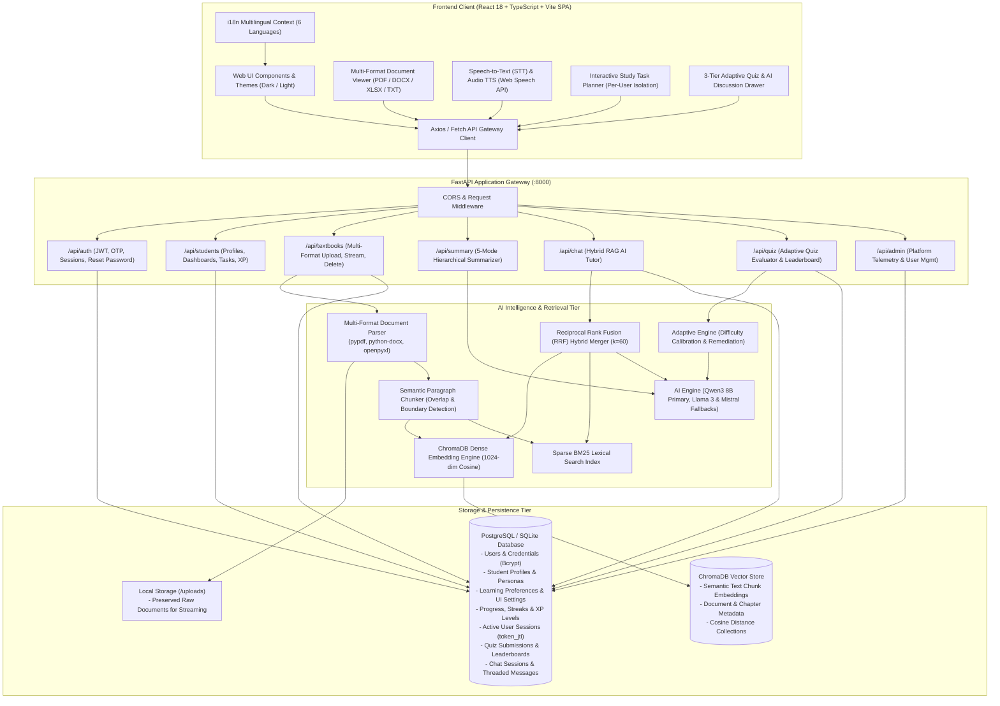
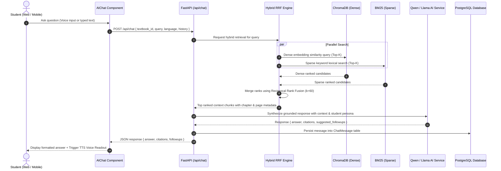
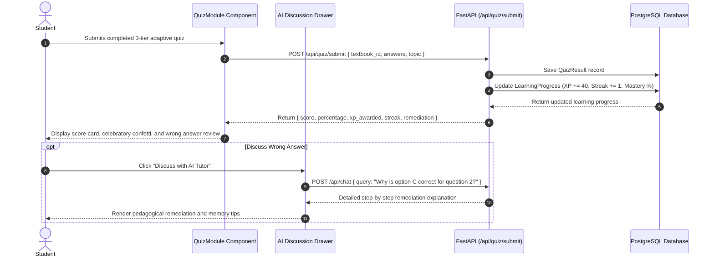
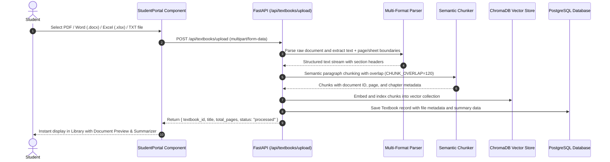

# Architecture Overview – AARVA System

**AARVA** (AI-Based Adaptive Learning & Document Intelligence System) is an enterprise-grade, modular educational platform engineered for personalized learning across school students, college undergraduates, working professionals, and lifelong learners.

---

## 1. System Architecture Diagram

---

## 2. Key Architectural Layers

### A. Client Layer (Frontend SPA)
- **Framework**: React 18, TypeScript, Vite.
- **State Management & Contexts**:
  - `AuthContext`: Role-based authentication (`student` / `admin`), JWT token persistence in `localStorage`, user session sync, and persona demo switching.
  - `ThemeContext`: Dynamic light and dark mode toggling, 6-language internationalization (English, Hindi, Tamil, Telugu, Spanish, French), and Web Speech API synthesis/recognition.
- **Component Architecture**:
  - `UniversalSignup.tsx`: 4-step dynamic adaptive onboarding stepper with persona-tailored inputs (School, College, Professional, Independent).
  - `StudentPortal.tsx`: Dual-view learning space coordinator featuring:
    - Left side: Full Document & Spreadsheet Viewer (`iframe` / PDF preview, DOCX, XLSX rendering) with tab toggle to AI Tutor Chat.
    - Right side: Hierarchical Document Summarizer (Complete Book, Chapter Breakdown, Core Concepts, Glossary, Important Notes) with Markdown & Print export.
  - `AIChat.tsx`: Real-time RAG-powered tutor with grounded chapter and page citations, audio speech playback, and suggested follow-ups.
  - `QuizModule.tsx`: 3-tier adaptive practice quizzes (Basic, Medium, Advanced) with instant pedagogical answers, celebratory confetti, and wrong-answer AI Discussion drawer.
  - `ProgressView.tsx`: Daily streak counter (🔥), concept mastery meters, and XP level progression.
  - `AdminPortal.tsx`: System telemetry dashboard, student inspection modal, and account suspension controls.

### B. Gateway & API Layer (FastAPI Backend)
- **FastAPI**: Asynchronous Python ASGI web server providing interactive OpenAPI (Swagger) documentation and typed Pydantic validation.
- **Security & Session Management**:
  - Passwords hashed with `bcrypt` (12 rounds).
  - Stateless JSON Web Tokens (`HS256`) paired with database-backed `user_sessions` tracking for multi-device visibility and instant session revocation.
  - Email verification codes and password recovery dispatched via SMTP (`services/email_service.py`).

### C. Multi-Format Ingestion & Hybrid RRF Retrieval Pipeline
- **Document Parsing**: Ingests PDFs (`pypdf`), Word documents (`python-docx`), Excel spreadsheets (`openpyxl`), and plain text (`.txt`).
- **Semantic Paragraph Chunker**: Splits documents into cohesive chunks respecting paragraph boundaries, headers, and bullet structures with configurable overlaps (`CHUNK_OVERLAP=120`).
- **Hybrid Retrieval (Dense + BM25 + RRF)**:
  - Dense similarity search via ChromaDB vector embeddings (1024-dim cosine distance).
  - Sparse lexical search via BM25 to catch exact terminology, acronyms, formulas, and section identifiers.
  - **Reciprocal Rank Fusion (RRF)**:
    $$\text{RRF Score}(d) = w_{\text{dense}} \cdot \frac{1}{k + \text{rank}_{\text{dense}}(d)} + w_{\text{sparse}} \cdot \frac{1}{k + \text{rank}_{\text{sparse}}(d)}$$
    Where $k = 60$, $w_{\text{dense}} = 0.65$, and $w_{\text{sparse}} = 0.35$.
- **Primary AI Engine (`Qwen3 8B` / `Qwen2.5`)**:
  - Serves as the primary inference model for chapter summarization, key concept extraction, adaptive question generation, and grounded RAG tutor chat.
  - Automated fallback to `Llama 3`, `Mistral`, or local CPU/GPU profiles via Ollama.

---

## 3. End-to-End Workflow Diagrams

### A. Hybrid RAG AI Tutor Chat Pipeline

### B. 3-Tier Adaptive Quiz Submission & Remediation

### C. Multi-Format Document Ingestion & Vector Indexing

