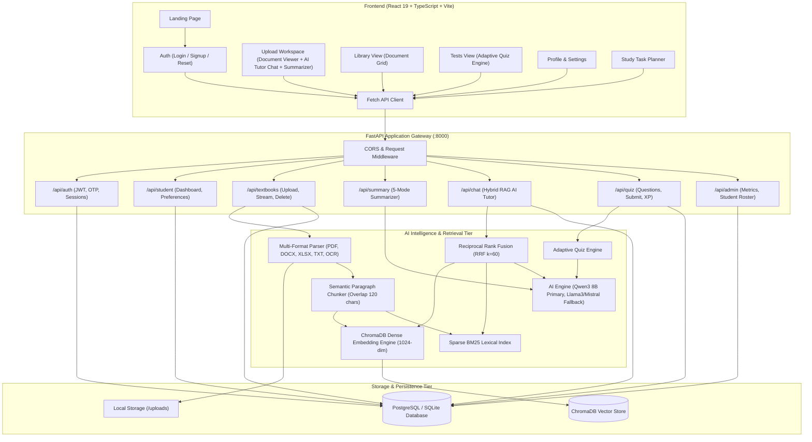
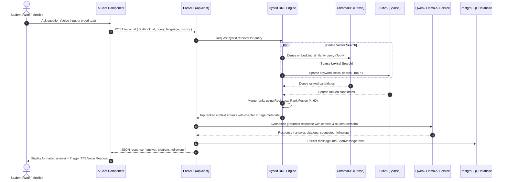
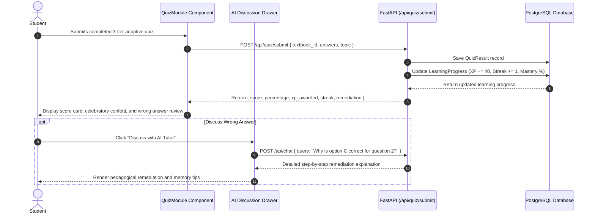
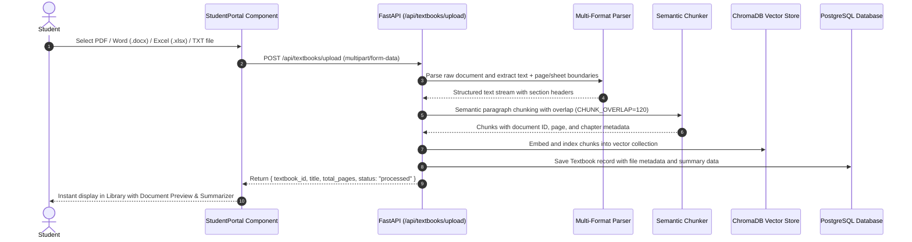

# Architecture Overview – AARVA System

**AARVA** (AI-Based Adaptive Learning & Document Intelligence System) is an enterprise-grade, modular educational platform engineered for personalized learning across school students, college undergraduates, working professionals, and lifelong learners.

---

## 1. System Architecture Diagram

---

## 2. Key Architectural Layers

### A. Client Layer (Frontend SPA)
- **Framework**: React 18, TypeScript, Vite.
- **Architecture**: The entire frontend lives in a **single `App.tsx`** file with all pages and components co-located. Styles are in `index.css`.
- **State**: JWT token and user object stored in `localStorage`. Study task planner state persisted in `localStorage` per `user_id`.
- **Pages & Components (all in `App.tsx`)**:
  - `LandingPage`: Public marketing page — hero, features, about, contact, and email subscribe form.
  - `AuthPage`: Login form, 3-step signup (personal info → interests/preferences → 4-digit OTP verify), forgot-password with OTP reset, and demo credential fill.
  - `Dashboard`: Sidebar nav shell with collapsible sidebar, top bar (points, notifications, profile chip).
    - `UploadWorkspace` (`active === "Upload"`): Left pane — in-browser PDF rendering (`pdfjs-dist`), file preview, and Hybrid RAG AI Tutor Chat. Right pane — 5-mode document summarizer.
    - `LibraryView` (`active === "Library"`): Grid of all uploaded books with cover colors; open a book or start a test.
    - `TestView` (`active === "Tests"`): Quiz engine — generate questions, display MCQs, submit for scoring, show score card with XP and feedback.
    - `ProfileView` (`active === "Profile"`): Name, email, and book count display.
    - `SettingsView` (`active === "Settings"`): Toggle learning preferences (TTS, STT, larger text, simplified explanations).
  - `FilePreviewPane`: Inline PDF page-by-page renderer using `pdfjs-dist`.

### B. Gateway & API Layer (FastAPI Backend)
- **FastAPI**: Asynchronous Python ASGI web server providing interactive OpenAPI (Swagger) documentation and typed Pydantic validation.
- **Security & Session Management**:
  - Passwords hashed with `bcrypt` (12 rounds).
  - Stateless JSON Web Tokens (`HS256`) paired with database-backed `user_sessions` tracking for multi-device visibility and instant session revocation.
  - Email verification codes and password recovery dispatched via SMTP (`services/email_service.py`).

### C. Multi-Format Ingestion & Hybrid RRF Retrieval Pipeline
- **Document Parsing**: Ingests PDFs (`pypdf`), Word documents (`python-docx`), Excel spreadsheets (`openpyxl`), and plain text (`.txt`).
- **Semantic Paragraph Chunker**: Splits documents into cohesive chunks respecting paragraph boundaries, headers, and bullet structures with configurable overlaps (`CHUNK_OVERLAP=120`).
- **Hybrid Retrieval (Dense + BM25 + RRF)**:
  - Dense similarity search via ChromaDB vector embeddings (1024-dim cosine distance).
  - Sparse lexical search via BM25 to catch exact terminology, acronyms, formulas, and section identifiers.
  - **Reciprocal Rank Fusion (RRF)**:
    $$\text{RRF Score}(d) = w_{\text{dense}} \cdot \frac{1}{k + \text{rank}_{\text{dense}}(d)} + w_{\text{sparse}} \cdot \frac{1}{k + \text{rank}_{\text{sparse}}(d)}$$
    Where $k = 60$, $w_{\text{dense}} = 0.65$, and $w_{\text{sparse}} = 0.35$.
- **Primary AI Engine (`Qwen3 8B` / `Qwen2.5`)**:
  - Serves as the primary inference model for chapter summarization, key concept extraction, adaptive question generation, and grounded RAG tutor chat.
  - Automated fallback to `Llama 3`, `Mistral`, or local CPU/GPU profiles via Ollama.

---

## 3. End-to-End Workflow Diagrams

### A. Hybrid RAG AI Tutor Chat Pipeline

### B. 3-Tier Adaptive Quiz Submission & Remediation

### C. Multi-Format Document Ingestion & Vector Indexing

---

## 4. Tech Stack & Libraries — Detailed Architectural Specification

### A. Core Architectural Tech Stack Table

| Layer / Domain | Technology | Type / Specification | Role in AARVA |
| :--- | :--- | :--- | :--- |
| **Frontend Framework** | **React 19** | SPA (Component Hierarchy & State) | Reactive component tree, custom hooks, and virtual DOM diffing in `App.tsx` |
| **Language** | **TypeScript 5.7** | Static Typing | Strict typing across interfaces, props, models, and API responses |
| **Styling Engine** | **Tailwind CSS v4** + Vanilla CSS | Modern CSS System | Glassmorphism UI, design tokens, CSS variables, and responsive layout |
| **Build Tool & Bundler** | **Vite 8** | Dev Server & Bundler | Lightning-fast Native ESM dev server and production builder |
| **Backend Framework** | **FastAPI** | Asynchronous Web Framework | High-performance Python 3.10+ REST API with auto-generated OpenAPI docs (`/docs`) |
| **ASGI Server** | **Uvicorn** | Asynchronous Server | High-throughput server running on `uvloop` and `httptools` |
| **Database & ORM** | **PostgreSQL / SQLite** + **SQLAlchemy 2.0** | Relational DB & ORM | Persistent storage for users, sessions, textbooks, quizzes, and chat messages |
| **Vector Store** | **ChromaDB** | Embedded Vector Database | Persistent local vector store (`./chroma_db`) with cosine distance indexing |
| **Retrieval Architecture** | **Hybrid RAG (Dense + BM25 + RRF)** | Retrieval Engine | Reciprocal Rank Fusion (`k=60`) merging ChromaDB vector search + BM25 lexical search |
| **LLM Inference Engine** | **Ollama** | Local AI Host | Local model execution engine (`http://localhost:11434`) with zero API cost |
| **Large Language Models** | **Qwen3 8B**, **Llama 3**, **Mistral** | Generative AI | Multi-turn AI tutor chat, 5-mode summarization, and adaptive quiz generation |
| **Embedding Model** | **BGE-Large** (`bge-large:latest`) | Dense Semantic Embedding | 1024-dimensional dense semantic vectors for ChromaDB indexing |
| **Document Preview** | **Multi-Format In-Browser Preview** | Client Rendering | In-browser rendering of PDF canvas, Word HTML, and Excel interactive tables |
| **OCR & Vision** | **EasyOCR** + **Tesseract OCR** | Optical Character Recognition | Scanned document and image text extraction supporting 80+ languages |
| **Voice / Speech** | **Web Speech API** | Browser Native Voice | SpeechRecognition (STT voice-to-text) and SpeechSynthesis (TTS voice readout) |
| **Auth & Security** | **JWT (HS256)** + **Bcrypt** | Token Auth & Hashing | Stateless Bearer token auth and 12-round salted password hashing |
| **Mail / SMTP** | **Gmail SMTP (TLS:587)** | Email Dispatch | 4-digit verification OTP transmission and password reset flows |

---

### B. Document Preview Engines & Libraries Table

| Document Type | Preview Library / Package | Version | Rendering Method & User Experience |
| :--- | :--- | :--- | :--- |
| **PDF Documents (`.pdf`)** | **`pdfjs-dist`** | `^6.4.299` | Mozilla PDF.js client engine parses binary streams and renders pages onto HTML5 canvas with page navigation |
| **Word Documents (`.docx`)** | **`mammoth`** | `^1.13.0` | Client-side parser converts Word `.docx` structures directly to sanitized HTML for instant in-browser reading |
| **Excel Spreadsheets (`.xlsx`, `.xls`)** | **`xlsx` (SheetJS)** | `^0.18.5` | In-browser spreadsheet parser converts sheets and workbooks into interactive, scrollable HTML data tables |
| **Markdown & AI Notes (`.md`)** | **`react-markdown`** | `^10.1.0` | Client markdown parser rendering bold key terms, headings, bullet lists, code blocks, and formatted study guides |
| **Plain Text (`.txt`, `.csv`, `.rst`)** | Native Browser Reader | Native | Streaming text decoder rendering plain text files with preserved line breaks and formatting |

---

### C. Large Language Models (LLM) & AI Intelligence Table

| Model / Service | Identifier / URI | Model Type | Parameters & Config | Role in AARVA |
| :--- | :--- | :--- | :--- | :--- |
| **Qwen3 8B** | `qwen3:8b` (via Ollama) | **Primary LLM** | 8B parameters, `temperature=0.3`, `max_tokens=1024`, `timeout=45s` | Generates 5-mode document summaries, multi-turn RAG AI tutor responses, and adaptive quiz questions |
| **Llama 3** | `llama3:latest` (via Ollama) | **Fallback LLM** | 8B parameters, `temperature=0.3`, `max_tokens=1024` | Automatic secondary model invoked if Qwen3 is not pulled or Ollama returns an error |
| **Mistral** | `mistral:latest` (via Ollama) | **Fallback LLM** | 7B parameters, `temperature=0.3`, `max_tokens=1024` | Tertiary fallback conversational model for fast summarization |
| **BGE-Large** | `bge-large:latest` (via Ollama) | **Embedding Model** | 1024-dimensional dense semantic vector output | Converts semantic text chunks into vector embeddings stored in ChromaDB for cosine search |
| **Ollama Daemon** | `http://localhost:11434` | **Local AI Server** | GPU/CPU local inference server | Manages weights, context windows, and provides REST endpoints (`/api/generate`, `/api/embeddings`) |

---

### D. Libraries & Dependencies Inventory Table (Complete Catalog)

| Library / Package | Version | Layer | Category | What It Does & Key Role in AARVA |
| :--- | :--- | :--- | :--- | :--- |
| **`pdfjs-dist`** | `^6.4.299` | Frontend | **Document Preview** | Parses PDF binary files and renders pages onto HTML5 canvas in the left workspace pane |
| **`mammoth`** | `^1.13.0` | Frontend | **Document Preview** | Converts Microsoft Word `.docx` documents to clean HTML previews |
| **`xlsx`** | `^0.18.5` | Frontend | **Document Preview** | SheetJS library parsing Excel workbooks into interactive data tables |
| **`react-markdown`** | `^10.1.0` | Frontend | **Content Rendering** | Markdown parser rendering AI responses, study takeaways, and concept explanations |
| **`react`** | `^19.0.0` | Frontend | **Core UI** | Component hierarchy, custom hooks, and virtual DOM diffing |
| **`react-dom`** | `^19.0.0` | Frontend | **Core UI** | Client-side DOM mounting and reconciliation |
| **`typescript`** | `^5.7.0` | Frontend | **Language** | Static typing across components, models, and API response schemas |
| **`vite`** | `^8.0.5` | Frontend | **Tooling / Bundler** | Native ESM dev server and production builder |
| **`@vitejs/plugin-react`** | `^6.0.0` | Frontend | **Tooling** | React 19 Fast Refresh and JSX transformation |
| **`tailwindcss`** | `^4.0.0` | Frontend | **Styling** | Utility-first CSS engine powering glassmorphism design and responsive layout |
| **`@tailwindcss/vite`** | `^4.0.0` | Frontend | **Styling** | Direct Tailwind v4 Vite compilation plugin |
| **`oxfmt`** | `^0.2.0` | Frontend | **Code Quality** | Ultra-fast Rust-based code formatter |
| **`fastapi`** | `>=0.110.0` | Backend | **API Framework** | Async REST web router with Pydantic validation and automatic OpenAPI Swagger docs |
| **`uvicorn`** | `>=0.28.0` | Backend | **ASGI Server** | High-throughput server running the FastAPI app on `0.0.0.0:8000` |
| **`pydantic`** | `>=2.6.0` | Backend | **Data Validation** | Schema validation, type enforcement, and settings management |
| **`python-multipart`** | `>=0.0.9` | Backend | **File Upload** | Streaming multipart form parser for multi-megabyte document uploads |
| **`sqlalchemy`** | `>=2.0.28` | Backend | **ORM / Database** | Declarative SQL models for users, sessions, textbooks, quizzes, and chat history |
| **`psycopg2-binary`** | `>=2.9.9` | Backend | **Database Driver** | C-optimized PostgreSQL database driver |
| **`pg8000`** | `>=1.31.0` | Backend | **Database Driver** | Pure-Python PostgreSQL driver fallback |
| **`chromadb`** | `>=0.4.24` | Backend | **Vector Database** | Embedded vector database (`./chroma_db`) storing 1024-dim dense embeddings |
| **`rank-bm25`** | `>=0.2.2` | Backend | **Lexical Search** | BM25 Okapi lexical sparse ranking for hybrid keyword retrieval |
| **`requests`** | `>=2.31.0` | Backend | **LLM Integration** | HTTP client sending queries and embeddings requests to Ollama |
| **`python-jose[crypto]`** | `>=3.3.0` | Backend | **Auth & Security** | JWT generation, HS256 signing, and Bearer token verification |
| **`passlib[bcrypt]`** | `>=1.7.4` | Backend | **Auth & Security** | 12-round salted bcrypt password hashing |
| **`PyMuPDF` (`fitz`)** | `>=1.24.0` | Backend | **Document Parsing** | Fast C-backed PDF text and page extraction |
| **`pdfplumber`** | `>=0.11.0` | Backend | **Document Parsing** | Layout-aware fallback for multi-column pages and structured tables |
| **`python-docx`** | `>=1.1.0` | Backend | **Document Parsing** | Extracts paragraphs, headings, bullet lists, and tables from `.docx` files |
| **`mammoth`** | `>=1.6.0` | Backend | **Document Parsing** | Word `.doc`/`.docx` text extraction fallback |
| **`openpyxl`** | `>=3.1.2` | Backend | **Document Parsing** | Excel `.xlsx`/`.xls` workbook and sheet tabular cell parser |
| **`chardet`** | `>=5.2.0` | Backend | **Document Parsing** | Universal character encoding detector for plain text files |
| **`Pillow`** | `>=10.3.0` | Backend | **Vision / OCR** | Image loading, resizing, grayscale conversion, and contrast enhancement |
| **`pytesseract`** | `>=0.3.10` | Backend | **Vision / OCR** | Tesseract OCR wrapper for text extraction from images |
| **`easyocr`** | `>=1.7.1` | Backend | **Vision / OCR** | Standalone deep learning OCR supporting 80+ languages |

