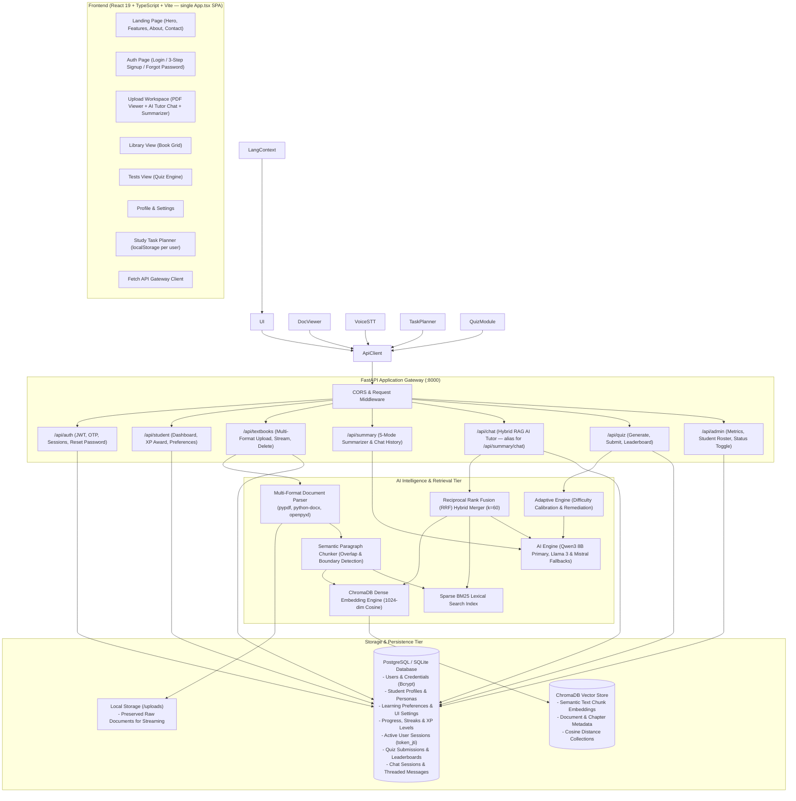
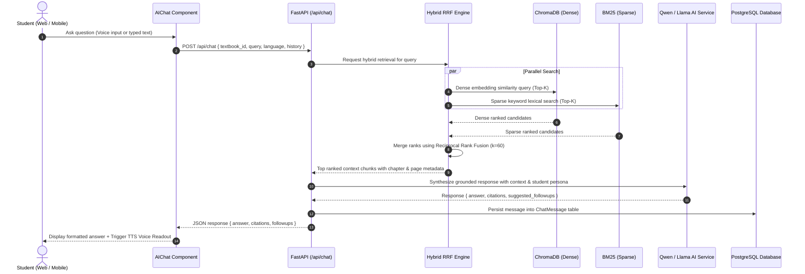
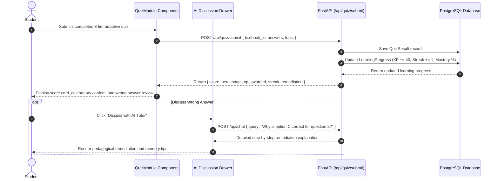
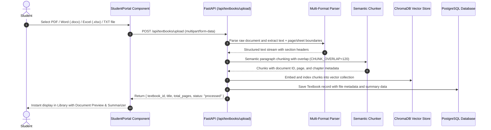

# Architecture Overview – AARVA System

**AARVA** (AI-Based Adaptive Learning & Document Intelligence System) is an enterprise-grade, modular educational platform engineered for personalized learning across school students, college undergraduates, working professionals, and lifelong learners.

---

## 1. System Architecture Diagram

---

## 2. Key Architectural Layers

### A. Client Layer (Frontend SPA)
- **Framework**: React 18, TypeScript, Vite.
- **Architecture**: The entire frontend lives in a **single `App.tsx`** file with all pages and components co-located. Styles are in `index.css`.
- **State**: JWT token and user object stored in `localStorage`. Study task planner state persisted in `localStorage` per `user_id`.
- **Pages & Components (all in `App.tsx`)**:
  - `LandingPage`: Public marketing page — hero, features, about, contact, and email subscribe form.
  - `AuthPage`: Login form, 3-step signup (personal info → interests/preferences → 4-digit OTP verify), forgot-password with OTP reset, and demo credential fill.
  - `Dashboard`: Sidebar nav shell with collapsible sidebar, top bar (points, notifications, profile chip).
    - `UploadWorkspace` (`active === "Upload"`): Left pane — in-browser PDF rendering (`pdfjs-dist`), file preview, and Hybrid RAG AI Tutor Chat. Right pane — 5-mode document summarizer.
    - `LibraryView` (`active === "Library"`): Grid of all uploaded books with cover colors; open a book or start a test.
    - `TestView` (`active === "Tests"`): Quiz engine — generate questions, display MCQs, submit for scoring, show score card with XP and feedback.
    - `ProfileView` (`active === "Profile"`): Name, email, and book count display.
    - `SettingsView` (`active === "Settings"`): Toggle learning preferences (TTS, STT, larger text, simplified explanations).
  - `FilePreviewPane`: Inline PDF page-by-page renderer using `pdfjs-dist`.

### B. Gateway & API Layer (FastAPI Backend)
- **FastAPI**: Asynchronous Python ASGI web server providing interactive OpenAPI (Swagger) documentation and typed Pydantic validation.
- **Security & Session Management**:
  - Passwords hashed with `bcrypt` (12 rounds).
  - Stateless JSON Web Tokens (`HS256`) paired with database-backed `user_sessions` tracking for multi-device visibility and instant session revocation.
  - Email verification codes and password recovery dispatched via SMTP (`services/email_service.py`).

### C. Multi-Format Ingestion & Hybrid RRF Retrieval Pipeline
- **Document Parsing**: Ingests PDFs (`pypdf`), Word documents (`python-docx`), Excel spreadsheets (`openpyxl`), and plain text (`.txt`).
- **Semantic Paragraph Chunker**: Splits documents into cohesive chunks respecting paragraph boundaries, headers, and bullet structures with configurable overlaps (`CHUNK_OVERLAP=120`).
- **Hybrid Retrieval (Dense + BM25 + RRF)**:
  - Dense similarity search via ChromaDB vector embeddings (1024-dim cosine distance).
  - Sparse lexical search via BM25 to catch exact terminology, acronyms, formulas, and section identifiers.
  - **Reciprocal Rank Fusion (RRF)**:
    $$\text{RRF Score}(d) = w_{\text{dense}} \cdot \frac{1}{k + \text{rank}_{\text{dense}}(d)} + w_{\text{sparse}} \cdot \frac{1}{k + \text{rank}_{\text{sparse}}(d)}$$
    Where $k = 60$, $w_{\text{dense}} = 0.65$, and $w_{\text{sparse}} = 0.35$.
- **Primary AI Engine (`Qwen3 8B` / `Qwen2.5`)**:
  - Serves as the primary inference model for chapter summarization, key concept extraction, adaptive question generation, and grounded RAG tutor chat.
  - Automated fallback to `Llama 3`, `Mistral`, or local CPU/GPU profiles via Ollama.

---

## 3. End-to-End Workflow Diagrams

### A. Hybrid RAG AI Tutor Chat Pipeline

### B. 3-Tier Adaptive Quiz Submission & Remediation

### C. Multi-Format Document Ingestion & Vector Indexing

---

## 4. Tech Stack & Libraries — Detailed Notes

### A. Frontend Architecture & Libraries (`frontend/package.json`)

| Package / Library | Version | Category | Purpose & Key Role in AARVA |
| :--- | :--- | :--- | :--- |
| **`react`** | `^19.0.0` | UI Core | Modern UI library powering component hierarchy, state reactivity, hooks, and virtual DOM diffing. |
| **`react-dom`** | `^19.0.0` | DOM Renderer | React renderer responsible for mounting and rendering components to the browser DOM. |
| **`typescript`** | `^5.7.0` | Language / Typing | Strict static typing for all frontend interfaces, props, API response models, and state schemas. |
| **`vite`** | `^8.0.5` | Bundler / Dev Server | High-performance build tool with Native ESM dev server and Lightning-fast Hot Module Replacement (HMR). |
| **`@vitejs/plugin-react`**| `^6.0.0` | Vite Plugin | Fast Refresh and JSX transformation support for React 19 within Vite. |
| **`tailwindcss`** | `^4.0.0` | Styling Engine | Modern CSS framework providing utility-first classes, CSS variables, dark mode styling, and responsive layout grids. |
| **`@tailwindcss/vite`** | `^4.0.0` | Vite Integration | Official Tailwind v4 Vite plugin for zero-configuration CSS compilation directly in the build pipeline. |
| **`pdfjs-dist`** | `^6.4.299` | Document Rendering | Mozilla PDF.js client library for parsing, loading, and rendering PDF documents canvas-by-canvas in the browser viewer. |
| **`mammoth`** | `^1.13.0` | Document Conversion | Client-side Word `.docx` to HTML converter for instant document previews without server trips. |
| **`xlsx`** | `^0.18.5` | Tabular Data | SheetJS library for parsing and rendering Excel spreadsheets (`.xlsx` / `.xls`) directly into interactive tables. |
| **`react-markdown`** | `^10.1.0` | Content Rendering | Markdown parser and renderer used to display structured AI notes, formatted explanations, and latex/code blocks. |
| **`oxfmt`** | `^0.2.0` | Code Quality | Ultra-fast Rust-based code formatter for maintaining consistent formatting across TypeScript and CSS files. |
| **`@types/node`** | `^22.0.0` | Type Definitions | TypeScript types for Node.js APIs used in Vite config scripts. |
| **`@types/react`** | `^19.0.0` | Type Definitions | TypeScript typings for React 19 component interfaces and standard React hooks. |
| **`@types/react-dom`** | `^19.0.0` | Type Definitions | TypeScript typings for React DOM entry points and root mounting methods. |

---

### B. Backend Architecture & Libraries (`backend/requirements.txt`)

#### 1. Core API & Web Framework
* **`fastapi` (`>=0.110.0`)**: High-performance, async-native Python web framework based on Starlette and Pydantic. Handles all REST endpoints, file streaming, dependency injection (DB sessions, auth guards), and auto-generates OpenAPI documentation (`/docs`).
* **`uvicorn` (`>=0.28.0`)**: Lightning-fast ASGI server implementation using `uvloop` and `httptools` to serve FastAPI concurrently under heavy load.
* **`pydantic` (`>=2.6.0`)**: Data validation and serialization using Python type annotations. Powers request/response schemas, type coercion, and environment settings.
* **`python-multipart` (`>=0.0.9`)**: Streaming parser for `multipart/form-data` uploads, enabling efficient handling of multi-megabyte document uploads (`.pdf`, `.docx`, `.xlsx`, `.txt`).

#### 2. Database & ORM
* **`sqlalchemy` (`>=2.0.28`)**: Python SQL toolkit and Object Relational Mapper (ORM) using modern 2.0 declarative models (`mapped_column`). Manages user accounts, textbooks, bookmarks, chat history, quiz submissions, and analytics records.
* **`psycopg2-binary` (`>=2.9.9`)**: PostgreSQL database adapter for production relational storage.
* **`pg8000` (`>=1.31.0`)**: Pure-Python PostgreSQL driver providing an alternative, lightweight interface for environments without precompiled C extensions.
* **`sqlite3` (Built-in)**: Zero-configuration default local database driver (`sqlite:///./aarva.db`) for lightweight development and offline environments.

#### 3. Vector Database & Hybrid Retrieval
* **`chromadb` (`>=0.4.24`)**: Embedded, open-source vector database configured with local persistence (`./chroma_db`). Stores dense vector embeddings of text chunks along with metadata (book ID, page number, chapter, chunk index) using cosine distance.
* **`rank-bm25` (`>=0.2.2`)**: Pure-Python implementation of BM25 (Okapi BM25) lexical ranking algorithms. Powers sparse keyword retrieval, which is combined with dense vector retrieval via Reciprocal Rank Fusion (RRF).

#### 4. Authentication & Security
* **`python-jose[cryptography]` (`>=3.3.0`)**: JavaScript Object Signing and Encryption (JOSE) implementation for generating and validating signed JWT access tokens (HS256).
* **`passlib[bcrypt]` (`>=1.7.4`)**: Password hashing library using the bcrypt algorithm (12 rounds) with automatic salting to protect user credentials.

#### 5. Document Parsing & Ingestion
* **`PyMuPDF` (`fitz` `>=1.24.0`)**: Ultra-fast C-backed PDF parser used for high-speed page-by-page text extraction, layout reading, and metadata retrieval.
* **`pdfplumber` (`>=0.11.0`)**: Precise PDF inspection engine used as a fallback for complex multi-column layouts and structured table extraction.
* **`python-docx` (`>=1.1.0`)**: Extracts paragraphs, headings, bullet lists, and tables from Microsoft Word (`.docx`) files.
* **`mammoth` (`>=1.6.0`)**: Converts Word `.docx` documents to clean semantic HTML and plain text with minimal formatting noise.
* **`openpyxl` (`>=3.1.2`)**: Reads Microsoft Excel (`.xlsx` / `.xls`) workbooks and sheets, formatting cell contents into structured markdown tables for RAG ingestion.
* **`Pillow` (`>=10.3.0`)**: Python Imaging Library (PIL Fork) for opening, resizing, contrast-adjusting, and preprocessing image scans before OCR.
* **`pytesseract` (`>=0.3.10`)**: Wrapper for Google Tesseract OCR engine, extracting plain text from scanned document images and handwritten notes.
* **`easyocr` (`>=1.7.1`)**: Deep learning-based optical character recognition supporting 80+ languages, operating as a standalone OCR fallback without external system dependencies.
* **`chardet` (`>=5.2.0`)**: Universal character encoding detector for accurately reading legacy plain-text files (UTF-8, Latin-1, Windows-1252, ASCII).

#### 6. Networking & AI Service Integrations
* **`requests` (`>=2.31.0`)**: Standard HTTP client for communicating with the local Ollama daemon (`http://localhost:11434`) for embedding generation (`bge-large`) and LLM chat/quiz generation (`qwen3:8b`).
* **`smtplib` / `email` (Built-in)**: Standard library modules configuring secure TLS email delivery (`smtp.gmail.com:587`) for OTP verification, password resets, and test report summaries.
