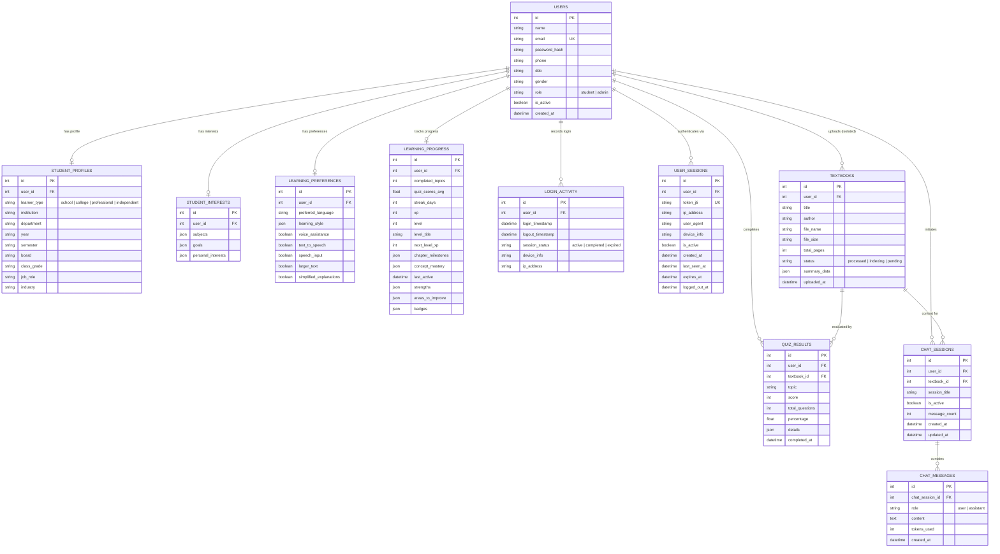
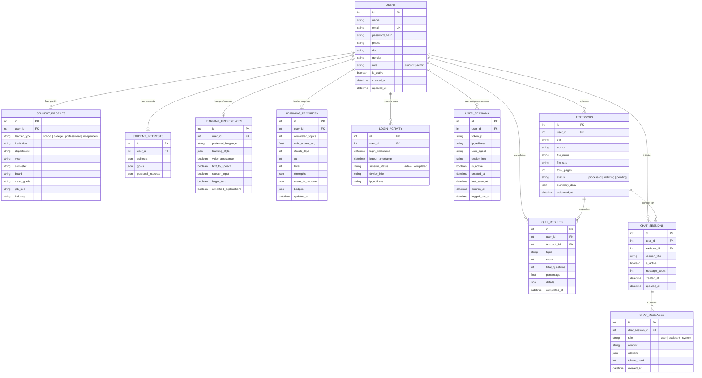

# Database Schema Documentation – AARVA

AARVA utilizes **PostgreSQL** (with local **SQLite** fallback for development) as its core relational data store. The database schema is managed via **SQLAlchemy ORM** in [`backend/models/models.py`](file:///d:/Aarva/backend/models/models.py).

> [!NOTE]
> **Per-User Data Isolation**: All document uploads, quiz results, chat sessions, and study tasks are strictly scoped by `user_id`. When a new user account is created, they start with a completely clean, empty workspace — no data from other users is ever visible.

---

## 1. Entity-Relationship (ER) Diagram

---

## 2. Table Specifications

### 1. `users`
Core user identity and authentication credentials. Foundation table for all cascading user data.

| Column | Type | Constraints | Notes |
|---|---|---|---|
| `id` | Integer | PK, Auto-increment, Index | Surrogate primary key |
| `name` | String(150) | Not Null | Full display name |
| `email` | String(255) | Unique, Index, Not Null | Login identifier |
| `password_hash` | String(255) | Not Null | Bcrypt (12 rounds) |
| `phone` | String(30) | Nullable | Optional phone number |
| `dob` | String(30) | Nullable | Date of birth (string) |
| `gender` | String(30) | Nullable | Optional gender field |
| `role` | String(30) | Default: `'student'` | Either `'student'` or `'admin'` |
| `is_active` | Boolean | Default: `True` | Account suspension flag |
| `created_at` | DateTime | Default: UTC now | Account creation timestamp |

---

### 2. `student_profiles`
Persona metadata per learner type. One-to-one relationship with `users`.

| Column | Type | Notes |
|---|---|---|
| `user_id` | Integer FK → `users.id` | CASCADE DELETE, Unique |
| `learner_type` | String(50) | `'school'`, `'college'`, `'professional'`, `'independent'` |
| `institution` | String(200) | College/university name |
| `department` | String(100) | e.g., CSE, Mechanical, Finance |
| `year` | String(30) | e.g., "3rd Year" |
| `semester` | String(30) | e.g., "5th Semester" |
| `board` | String(100) | e.g., CBSE, ICSE (school students) |
| `class_grade` | String(50) | e.g., "Class 11" (school students) |
| `job_role` | String(100) | e.g., "Cloud Solutions Architect" (professionals) |
| `industry` | String(100) | e.g., "Technology, Healthcare" (professionals) |

---

### 3. `student_interests` & `learning_preferences`
User-defined learning goals and accessibility/UI preferences stored as JSON arrays.

**`student_interests`**:
- `subjects` (JSON Array): e.g., `["Computer Networks", "Operating Systems"]`
- `goals` (JSON Array): e.g., `["Clear GATE 2026", "Land a product role"]`
- `personal_interests` (JSON Array): e.g., `["Photography", "Chess"]`

**`learning_preferences`**:
- `preferred_language` (String): `"English"`, `"Tamil"`, etc.
- `learning_style` (JSON Array): `["Short summaries", "Diagrams", "Step-by-step examples"]`
- `voice_assistance`, `text_to_speech`, `speech_input` (Boolean): Accessibility feature flags.
- `larger_text`, `simplified_explanations` (Boolean): Readability controls.

---

### 4. `learning_progress`
Gamification state and mastery analytics. One-to-one with `users`.

| Column | Type | Notes |
|---|---|---|
| `completed_topics` | Integer | Count of fully mastered topics |
| `quiz_scores_avg` | Float | Rolling average quiz performance |
| `streak_days` | Integer | Current consecutive active days |
| `xp` | Integer | Accumulated experience points (default: 240) |
| `level` | Integer | Current level (default: 3) |
| `level_title` | String(100) | e.g., `"Architecture Scholar"` |
| `next_level_xp` | Integer | XP threshold to reach next level |
| `chapter_milestones` | JSON | e.g., `{"ch_1": "completed", "ch_2": "in_progress"}` |
| `concept_mastery` | JSON | e.g., `{"TCP Slow Start": "mastered", "UDP": "learning"}` |
| `last_active` | DateTime | Last session activity timestamp |
| `strengths` | JSON | e.g., `["OSI Model", "Routing Protocols"]` |
| `areas_to_improve` | JSON | e.g., `["Congestion Control", "DNS Resolution"]` |
| `badges` | JSON | Array of unlocked achievement badge names |

---

### 5. `textbooks`
Metadata for uploaded and indexed documents. **Strictly per-user-isolated** (every query filters by `user_id`).

| Column | Type | Notes |
|---|---|---|
| `user_id` | Integer FK → `users.id` | CASCADE DELETE |
| `title` | String(255) | Document title |
| `author` | String(150) | Default: `"Unknown"` |
| `file_name` | String(255) | Original filename (PDF, DOCX, XLSX, TXT) |
| `file_size` | String(50) | Human-readable size (e.g., `"3.4 MB"`) |
| `total_pages` | Integer | Number of pages/sheets extracted |
| `status` | String(50) | `"processed"`, `"indexing"`, `"pending"` |
| `summary_data` | JSON | Cached 5-tier summary (overview, chapters, concepts, glossary, notes) |
| `uploaded_at` | DateTime | Upload timestamp |

---

### 6. `quiz_results`
Persists quiz submission details and scoring per user per document.

| Column | Type | Notes |
|---|---|---|
| `user_id` | Integer FK → `users.id` | CASCADE DELETE |
| `textbook_id` | Integer FK → `textbooks.id` | SET NULL on delete |
| `topic` | String(150) | Topic or difficulty tier label |
| `score` | Integer | Number of correct answers |
| `total_questions` | Integer | Questions in the quiz |
| `percentage` | Float | Score percentage |
| `details` | JSON | Per-question details with selected and correct answers |
| `completed_at` | DateTime | Submission timestamp |

---

### 7. `user_sessions`
JWT session tracking for security and multi-device awareness. Each login creates one `UserSession` row keyed by `token_jti` (JWT ID claim).

| Column | Type | Notes |
|---|---|---|
| `user_id` | Integer FK → `users.id` | CASCADE DELETE, Index |
| `token_jti` | String(255) | Unique JWT ID claim — used to revoke sessions on logout |
| `ip_address` | String(50) | Login IP address |
| `user_agent` | String(300) | Browser & OS fingerprint |
| `device_info` | String(150) | Derived device label (e.g., `"Web Browser"`) |
| `is_active` | Boolean | False after logout or expiry |
| `created_at` | DateTime | Session creation time |
| `last_seen_at` | DateTime | Most recent API call timestamp |
| `expires_at` | DateTime | JWT expiry date (default: 7 days) |
| `logged_out_at` | DateTime | Explicit logout timestamp |

> [!IMPORTANT]
> On every authenticated API call, middleware validates the `token_jti` from the JWT payload against the `user_sessions` table's `is_active` flag — enabling instant server-side session revocation without waiting for JWT natural expiry.

---

### 8. `chat_sessions` & `chat_messages`
Threaded AI tutor conversation history grouped by document and user.

**`chat_sessions`**: Groups a series of student↔AI messages for one specific textbook session.
- `session_title` (String): Auto-derived from the first student message.
- `message_count` (Integer): Incremented on each new message.
- `is_active` (Boolean): Marks the most recent active conversation thread.

**`chat_messages`**: Individual messages within a `ChatSession`.
- `role` (String): `"user"` or `"assistant"`
- `content` (Text): Full message body (supports long AI responses)
- `tokens_used` (Integer): Nullable; token count for billing/monitoring

---

### 9. `login_activity`
Audit log table recording every login and logout event per user for admin inspection.

| Column | Notes |
|---|---|
| `login_timestamp` | UTC datetime of login |
| `logout_timestamp` | UTC datetime of logout (Nullable) |
| `session_status` | `"active"`, `"completed"`, `"expired"` |
| `ip_address` | Source IP of login request |
| `device_info` | Browser/device User-Agent string |

---

## 1. Entity-Relationship (ER) Diagram

---

## 2. Table Specifications

### 1. `users`
Core user identity and authentication credentials.
- `id` (Integer, Primary Key, Auto-increment)
- `name` (String(120), Nullable=False)
- `email` (String(255), Unique=True, Index=True, Nullable=False)
- `password_hash` (String(255), Nullable=False) – Bcrypt hashed password
- `phone` (String(30), Nullable=True)
- `dob` (String(20), Nullable=True)
- `gender` (String(20), Nullable=True)
- `role` (String(20), Default='student') – Either `'student'` or `'admin'`
- `is_active` (Boolean, Default=True) – Account suspension flag
- `created_at` (DateTime, Default=UTC now)
- `updated_at` (DateTime, Default=UTC now)

### 2. `student_profiles`
Persona metadata customized for school, college, professional, or independent learners.
- `user_id` (Integer, Foreign Key to `users.id`, Unique=True)
- `learner_type` (String(50)) – `'school'`, `'college'`, `'professional'`, `'independent'`
- `institution`, `department`, `year`, `semester` – For college undergraduates
- `board`, `class_grade` – For school students (e.g. CBSE Class 11)
- `job_role`, `industry` – For working professionals

### 3. `student_interests` & `learning_preferences`
- JSON-encoded arrays of subjects, goals, personal passions.
- Accessibility & UI preferences including preferred language, speech TTS, STT voice input, and larger font settings.

### 4. `learning_progress` & `quiz_results`
- Tracks gamification metrics (XP points, current level, active day streaks).
- Records topic-by-topic strengths and areas needing review.
- Persists full quiz answer submissions with percentage scores.

### 5. `textbooks` & Vector Indexing
- Stores uploaded document references, file sizes, total page counts, and pre-computed hierarchical summaries (complete overview, chapter summaries, key takeaways, glossary terms).

### 6. `user_sessions`, `chat_sessions`, `chat_messages`
- Full tracking of active JWT sessions for security compliance.
- Threaded conversation histories with RAG citations for the Mistral AI tutor.
